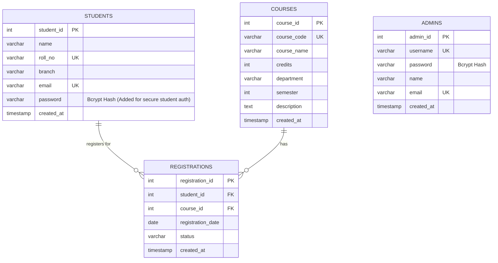

# Student Course Registration System

A full-stack, responsive, and robust **Student Course Registration System** engineered with **HTML5, CSS3, vanilla JavaScript, Node.js, Express.js, and MySQL (via `mysql2`)**.

---

## 🌟 Technology Stack

- **Frontend:** HTML5, Modern CSS3 (Responsive Design System, Custom Properties, Glassmorphic Dashboard), Vanilla JavaScript (Modular Fetch API & Toast System)
- **Backend:** Node.js with Express.js (Modular Express Routers, Session-Based Authentication, Role-Based Access Control)
- **Database:** MySQL 8.0
- **Database Connectivity:** `mysql2/promise` with Connection Pooling & Parameterized SQL Queries (SQL Injection Prevention)
- **Security:** Bcrypt password hashing (`bcryptjs`), HTTP-only secure session cookies (`express-session`), and multi-tier role authorization.

---

## 🏛️ Database Design (`student_course_registration`)

The database is built around the three main tables specified in the requirements, with foreign key referential integrity and duplicate registration constraints:



### Explanation of Schema Extensions
As required by the specifications:
> *"Do not unnecessarily change the given database structure. If additional tables or columns are required for a feature, explain why before introducing them."*

1. **`students.password` (VARCHAR(255) NOT NULL):**
   - **Reason:** Required to satisfy Backend Requirements ("Create student account", "Student login", "Hash passwords using bcrypt"). A student must have a secure hashed password to authenticate and establish an active session.
2. **`admins` table (`admin_id`, `username`, `password`, `name`, `email`):**
   - **Reason:** Required to satisfy Backend Requirements ("Admin login", "Restrict administrative operations to authenticated administrators", "Hash passwords using bcrypt"). Maintaining administrators in a dedicated table guarantees strict separation of privileges and prevents student privilege escalation.
3. **`courses.description` (TEXT):**
   - **Reason:** Provides syllabus outlines and prerequisite details to enhance the course catalog view on both student and admin dashboards.

---

## 📁 Project Structure

```
studentCourseRegistrationSystem/
├── config/
│   └── db.js                 # MySQL connection pool configuration (mysql2/promise)
├── database/
│   └── schema.sql            # Full MySQL DDL script with constraints and indexes
├── middleware/
│   └── auth.js               # isAuthenticated, isStudent, isAdmin middleware
├── public/                   # Static Frontend Client
│   ├── css/
│   │   └── style.css         # Modern, cohesive CSS design system
│   ├── js/
│   │   └── api.js            # Shared Fetch API helper, session check & toast alerts
│   ├── index.html            # Landing / Home page
│   ├── login.html            # Multi-role Login page (Student & Admin)
│   ├── register.html         # Student account creation page
│   ├── student/
│   │   ├── dashboard.html    # Student dashboard & summary stats
│   │   ├── courses.html      # Available courses catalog with search & filters
│   │   ├── register-course.html # Dedicated course registration workflow
│   │   ├── my-courses.html   # My registered courses & printable slip
│   │   └── profile.html      # Student personal profile details
│   └── admin/
│       ├── dashboard.html    # Admin analytics & overview dashboard
│       ├── courses.html      # Course catalog manager with quick actions
│       ├── add-course.html   # Add course page
│       ├── edit-course.html  # Modify course page
│       ├── students.html     # Registered students directory & registration records
│       ├── registrations.html# Master registration list & status manager
│       └── course-students.html # Students registered for a particular course
├── routes/
│   ├── authRoutes.js         # Student/Admin login, registration, logout, session
│   ├── studentRoutes.js      # Student profile, available courses, registration, drop
│   └── adminRoutes.js        # Admin course CRUD, student roster, registration management
├── scripts/
│   ├── init-db.js            # Automatic database & seed data initialization script
│   └── test-system.js        # Automated test suite (20 automated end-to-end tests)
├── .env                      # Environment configuration
├── .env.example              # Template for environment configuration
├── package.json              # NPM metadata and dependencies
└── server.js                 # Express application entrypoint
```

---

## 🔐 Credentials for Testing

The system is pre-seeded with sample credentials for immediate testing:

### Administrator Account
- **Portal:** `/login.html?role=admin`
- **Username:** `admin`
- **Password:** `admin123`

### Sample Student Accounts
- **Portal:** `/login.html`
- **Roll Number:** `21CS001`
- **Password:** `student123`
*(A second pre-seeded student is `21CS002` / `student123`, or you can register new students anytime at `/register.html`)*

---

## 🚀 Setup & Execution Guide

### 1. Prerequisites
- **Node.js** (v16.0 or higher)
- **MySQL Server** (v8.0 or higher)

### 2. Configure Database Credentials
Edit `.env` in the project root:
```env
PORT=3000
NODE_ENV=development

DB_HOST=localhost
DB_PORT=3306
DB_USER=root
DB_PASSWORD=your_mysql_password
DB_NAME=student_course_registration

SESSION_SECRET=student_course_reg_super_secure_secret_key_2026
```

### 3. Initialize Database & Seed Sample Data
Run the automated initialization script:
```bash
npm run init-db
```
*This creates the `student_course_registration` database, all tables, unique/foreign key constraints, and seeds 8 academic courses, 1 administrator, and 2 demo students with sample registrations.*

### 4. Run Automated System Tests
Execute the 20-test automated suite to verify all business rules, authentication, and REST endpoints:
```bash
node scripts/test-system.js
```

### 5. Start the Web Application
```bash
npm start
```
Open your browser and navigate to:
**`http://localhost:3000`**

---

## ⚙️ Core Business Rules Enforced

1. **Duplicate Registration Prevention:**
   - Enforced by both a MySQL composite unique constraint `UNIQUE (student_id, course_id)` and backend pre-check in `POST /api/student/register-course`. Returns HTTP `409 Conflict` with clear feedback if a student tries to register twice.
2. **Student Verification:**
   - Only registered students existing in the `students` table can register for courses.
3. **Course Existence:**
   - Students can register only for courses present in the `courses` table.
4. **Access Control & Privilege Separation:**
   - Express middleware `isAdmin` and `isStudent` reject unauthorized role access with `403 Forbidden`. Students cannot access administrator endpoints.
5. **Administrative Exclusivity:**
   - Only authenticated administrators can create, update, or delete courses.
6. **Automatic Registration Timestamps:**
   - System automatically records the registration date (`CURDATE()`) on course registration.
7. **Status Lifecycle:**
   - Statuses (`Registered`, `Approved`, `Pending`, `Dropped`, `Completed`) are tracked in the `registrations` table and can be administered through the Admin portal.
8. **Foreign Key Integrity:**
   - `ON DELETE CASCADE` and `ON UPDATE CASCADE` ensure referential integrity when courses or students are modified or deleted.

---

## 📡 REST API Reference

### Authentication (`/api/auth`)
| Method | Endpoint | Access | Description |
|---|---|---|---|
| `POST` | `/api/auth/student/register` | Public | Create new student account |
| `POST` | `/api/auth/student/login` | Public | Student login with roll number & password |
| `POST` | `/api/auth/admin/login` | Public | Administrator login with username & password |
| `GET` | `/api/auth/me` | Public | Get current session user profile |
| `POST` | `/api/auth/logout` | Public | Destroy session & logout |

### Student Operations (`/api/student`)
| Method | Endpoint | Access | Description |
|---|---|---|---|
| `GET` | `/api/student/profile` | Student | Get student personal details & credit statistics |
| `GET` | `/api/student/courses` | Student | Get available courses (with registration status flag) |
| `POST` | `/api/student/register-course` | Student | Register for a course (validates duplicates) |
| `GET` | `/api/student/my-courses` | Student | Get courses registered by the student |
| `DELETE`| `/api/student/drop-course/:id` | Student | Drop an enrolled course |

### Administrator Operations (`/api/admin`)
| Method | Endpoint | Access | Description |
|---|---|---|---|
| `GET` | `/api/admin/dashboard-stats` | Admin | Overall counts & department analytics |
| `GET` | `/api/admin/courses` | Admin | Get all courses with enrolled student counts |
| `POST` | `/api/admin/courses` | Admin | Add a new course |
| `GET` | `/api/admin/courses/:id` | Admin | Get specific course details |
| `PUT` | `/api/admin/courses/:id` | Admin | Update course details |
| `DELETE`| `/api/admin/courses/:id` | Admin | Delete a course |
| `GET` | `/api/admin/students` | Admin | Get all registered students with enrolled course counts |
| `GET` | `/api/admin/students/:id/registrations` | Admin | Get all course registrations for a specific student |
| `GET` | `/api/admin/courses/:id/students` | Admin | Get students registered for a specific course |
| `GET` | `/api/admin/registrations` | Admin | Master list of all registrations |
| `PATCH`| `/api/admin/registrations/:id/status` | Admin | Update registration status |
| `DELETE`| `/api/admin/registrations/:id` | Admin | Remove registration record |

